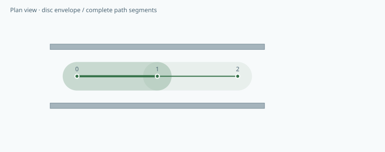
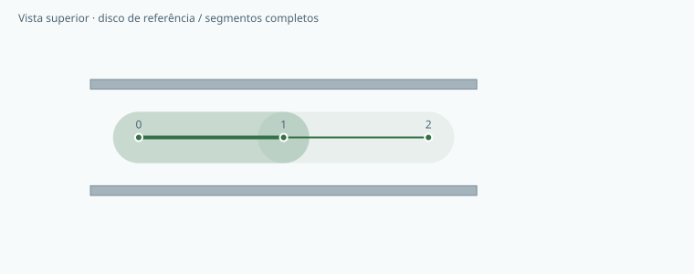

# Go2 PRO Clearance Bench

**Check the space swept by an entire path, including between waypoints.**  
**Analise o espaço percorrido pelo trajeto inteiro, inclusive entre pontos.**

[](https://github.com/galafis/go2-pro-clearance-bench/actions/workflows/ci.yml) · **v0.1.0** · **37 automated tests / testes automatizados** · **MIT**

[English](#english) · [Português](#portugues) · [Live workbench · Demonstração](https://galafis.github.io/go2-pro-clearance-bench/) · [Examples · Exemplos](#examples)

<a id="english"></a>

## English

A continuous-path geometry workbench that checks a conservative circular envelope against axis-aligned obstacles. It evaluates complete line segments, so an obstacle between two clear waypoints is still detected.

This is a software workbench in a research portfolio centered on the Unitree Go2 PRO. The current release runs independently of physical hardware.

### What works today

- Circumscribed body-disc model with an explicit additional margin.
- Exact segment-to-rectangle distance within the supplied planar model.
- Boundary-touching, zero-length segments and stationary footprints handled explicitly.
- Per-segment conflicts, minimum-clearance records and a swept-envelope visualization.
- A working adapter from contiguous Go2 PRO Telemetry Replay reports, with provenance and gap checks.



### Run it locally

Use **Node.js 22 or newer**. There are no third-party runtime packages to install.

```sh
git clone https://github.com/galafis/go2-pro-clearance-bench.git
cd go2-pro-clearance-bench
npm test
npm start
```

Open **http://127.0.0.1:4173**. The browser includes an English/Portuguese switch. Choose an example, adjust the primary assumption, and select **Update**. Expand **Edit all scenario fields** for the complete JSON editor. Invalid imports leave the last valid result visible with an explicit error message. Export both the scenario and report to preserve the experiment.

For headless use:

```sh
node scripts/analyze.mjs examples/nominal.json report.json
npm run examples
npm run test:coverage
```

The command-line exit codes are **0** for completed analysis or review notes, **2** for a valid scenario that needs review, and **1** for invalid input or invocation. A review-required result is still written to the requested report file.

### An experiment you can reproduce

The nominal 2 m-wide corridor uses a 0.70 × 0.31 m rectangle and 0.15 m additional margin. The resulting radius is about 0.533 m, leaving about 0.467 m to either wall. Adding a small box between waypoints changes the result to review-required, even though the waypoints themselves remain outside the box.

### How the result is calculated

- The envelope radius is half the body-rectangle diagonal plus marginM. It conservatively covers all orientations of that supplied rectangle, not the full moving robot.
- A slab-intersection test first identifies centerline intersection with an obstacle. Otherwise compute the minimum Euclidean distance between the path segment and the four rectangle edges.
- Subtract the envelope radius from centerline distance. Zero or negative clearance counts as contact or overlap; comparisons use a 1e-9 m numerical tolerance.

```text
radius = hypot(bodyLengthM, bodyWidthM) / 2 + marginM; clearance = distance(segment, rectangle) − radius
```

The [architecture guide](docs/ARCHITECTURE.md) explains every rule and boundary case. The [data contract](docs/DATA_CONTRACT.md) documents fields, units, limits and the report envelope. [Research scope](docs/RESEARCH_SCOPE.md) separates implemented behavior from future platform work.

### What the result does not establish

The model is two-dimensional and static. It excludes moving legs, people, vertical clearance, steps, slopes, localization uncertainty and braking. A negative value is an envelope-overlap indicator, not a measured penetration depth. A collision-free result applies only to supplied geometry and cannot be used as a physical guidance guarantee.

### Where this fits

Measure a controlled layout and coordinate frame, document the platform configuration, and replace the simplified footprint with an empirically justified envelope. Compare software findings with operator-supervised observations. Record mismatches, uncertainty and interruptions before considering any physical guidance study.

Related public project: [accessible-route-lab](https://github.com/galafis/accessible-route-lab). Each repository is independently runnable; a link does not imply a live integration. See [integration notes](docs/INTEGRATION.md) for the exact supported exchange, where present.

[Back to language navigation](#english)

---

<a id="portugues"></a>

## Português

Uma bancada geométrica de trajetos contínuos que verifica uma envoltória circular conservadora contra obstáculos alinhados aos eixos. Avalia segmentos completos; assim, um obstáculo entre dois pontos livres também é detectado.

Esta é uma bancada de software de um portfólio de pesquisa centrado no Unitree Go2 PRO. A versão atual funciona independentemente de hardware físico.

### O que já funciona

- Modelo de disco circunscrito ao corpo com margem adicional explícita.
- Distância exata entre segmento e retângulo dentro do modelo plano informado.
- Tratamento explícito de contato com limites, segmentos de comprimento zero e envoltórias estacionárias.
- Conflitos por segmento, registros do menor espaço livre e visualização da envoltória percorrida.
- Adaptador funcional para relatórios contínuos do Go2 PRO Telemetry Replay, com verificações de origem e lacunas.



### Executar localmente

Use **Node.js 22 ou mais recente**. Não há pacotes externos de execução para instalar.

```sh
git clone https://github.com/galafis/go2-pro-clearance-bench.git
cd go2-pro-clearance-bench
npm test
npm start
```

Abra **http://127.0.0.1:4173**. O navegador oferece alternância entre português e inglês. Escolha um exemplo, ajuste a hipótese principal e selecione **Atualizar**. Expanda **Editar todos os campos do cenário** para acessar o editor JSON completo. Importações inválidas mantêm o último resultado válido visível com mensagem explícita de erro. Exporte o cenário e o relatório para preservar o experimento.

Para usar sem interface gráfica:

```sh
node scripts/analyze.mjs examples/nominal.json report.json
npm run examples
npm run test:coverage
```

Os códigos de saída são **0** para análise concluída ou com notas, **2** para cenário válido que exige revisão e **1** para entrada ou chamada inválida. Resultados que exigem revisão também são gravados no arquivo de relatório solicitado.

### Um experimento reproduzível

O corredor nominal de 2 m de largura usa retângulo de 0,70 × 0,31 m e margem adicional de 0,15 m. O raio resultante é de aproximadamente 0,533 m, deixando cerca de 0,467 m até cada parede. Adicionar uma caixa pequena entre os pontos altera o resultado para revisão necessária, mesmo que os pontos permaneçam fora da caixa.

### Como o resultado é calculado

- O raio da envoltória é metade da diagonal do retângulo do corpo mais marginM. Ele cobre conservadoramente todas as orientações desse retângulo informado, não o robô inteiro em movimento.
- Primeiro, um teste de interseção por faixas identifica se a linha central atravessa o obstáculo. Caso contrário, calcule a menor distância euclidiana entre o segmento do trajeto e as quatro bordas do retângulo.
- Subtraia o raio da envoltória da distância à linha central. Espaço livre zero ou negativo representa contato ou sobreposição; as comparações usam tolerância numérica de 1e-9 m.

```text
radius = hypot(bodyLengthM, bodyWidthM) / 2 + marginM; clearance = distance(segment, rectangle) − radius
```

O [guia de arquitetura](docs/ARCHITECTURE.md) explica todas as regras e os casos limite. O [contrato de dados](docs/DATA_CONTRACT.md) documenta campos, unidades, limites e o formato do relatório. O [escopo de pesquisa](docs/RESEARCH_SCOPE.md) separa funcionalidades implementadas de futuras etapas com a plataforma.

### O que o resultado não comprova

O modelo é bidimensional e estático. Exclui pernas em movimento, pessoas, altura livre, degraus, inclinações, incerteza de localização e frenagem. Um valor negativo indica sobreposição da envoltória, não profundidade de penetração medida. Um resultado livre de colisão vale apenas para a geometria informada e não garante orientação física.

### Como este projeto se conecta ao portfólio

Meça um ambiente controlado e seu sistema de coordenadas, documente a configuração da plataforma e substitua a envoltória simplificada por uma referência justificada por medições. Compare os resultados do software com observações supervisionadas por operador. Registre divergências, incertezas e interrupções antes de considerar estudos de orientação física.

Projeto público relacionado: [accessible-route-lab](https://github.com/galafis/accessible-route-lab). Cada repositório funciona independentemente; um link não implica integração em tempo real. Consulte as [notas de integração](docs/INTEGRATION.md) para conhecer as trocas efetivamente suportadas, quando existentes.

---

<a id="examples"></a>

## Reproducible examples · Exemplos reproduzíveis

| Example · Exemplo                                    | Result · Resultado | Reproduce · Reproduzir                                                                                            |
| ---------------------------------------------------- | ------------------ | ----------------------------------------------------------------------------------------------------------------- |
| Wide corridor<br>Corredor amplo                      | `complete`         | [Input · Entrada](examples/nominal.json) · [Report · Relatório](examples/nominal.report.json)                     |
| Obstacle between waypoints<br>Obstáculo entre pontos | `review-required`  | [Input · Entrada](examples/between-waypoints.json) · [Report · Relatório](examples/between-waypoints.report.json) |
| Narrow corridor<br>Corredor estreito                 | `review-required`  | [Input · Entrada](examples/narrow-corridor.json) · [Report · Relatório](examples/narrow-corridor.report.json)     |

## Project guide · Guia do projeto

| Document · Documento                                          | Content · Conteúdo                                                                    |
| ------------------------------------------------------------- | ------------------------------------------------------------------------------------- |
| [Architecture · Arquitetura](docs/ARCHITECTURE.md)            | Domain rules, algorithms and boundaries · Regras, algoritmos e limites                |
| [Data contract · Contrato de dados](docs/DATA_CONTRACT.md)    | Fields, units and JSON format · Campos, unidades e formato JSON                       |
| [Schema](schemas/scenario.schema.json)                        | Structural JSON Schema · Esquema estrutural JSON                                      |
| [Validation · Validação](docs/VALIDATION.md)                  | Behavioral tests and review protocol · Testes de comportamento e protocolo de revisão |
| [Research scope · Escopo de pesquisa](docs/RESEARCH_SCOPE.md) | Platform relationship and next steps · Relação com a plataforma e próximas etapas     |
| [Integration · Integração](docs/INTEGRATION.md)               | Public artifact exchange · Troca de artefatos públicos                                |
| [Contributing · Contribuições](CONTRIBUTING.md)               | Development and review · Desenvolvimento e revisão                                    |
| [Security · Segurança](SECURITY.md)                           | Privacy and responsible reports · Privacidade e relatos responsáveis                  |
| [Changelog · Histórico](CHANGELOG.md)                         | Versioned changes · Alterações por versão                                             |

## Maintainer · Responsável

**Gabriel Demetrios Lafis** · Brazil / Brasil  
**[gabrieldemetrioslafis@usp.br](mailto:gabrieldemetrioslafis@usp.br)** · [GitHub](https://github.com/galafis)

Independent work; institutional contact does not imply institutional or vendor endorsement.  
Trabalho independente; o contato institucional não implica endosso de instituição ou fabricante.
